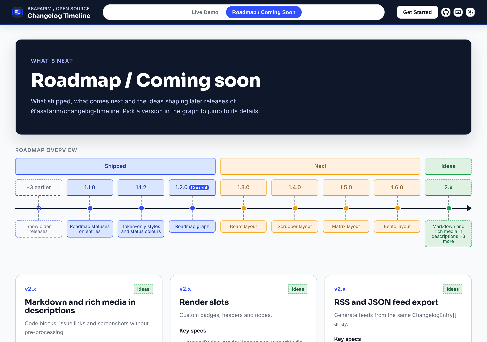
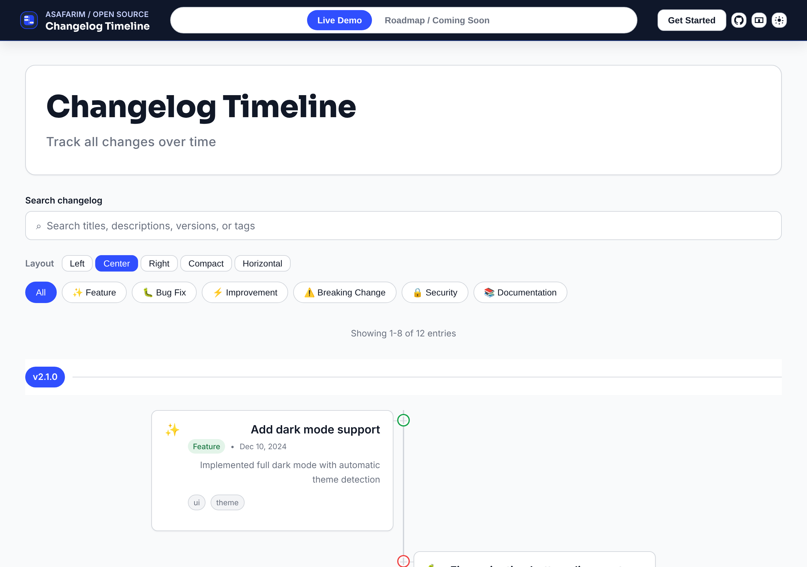
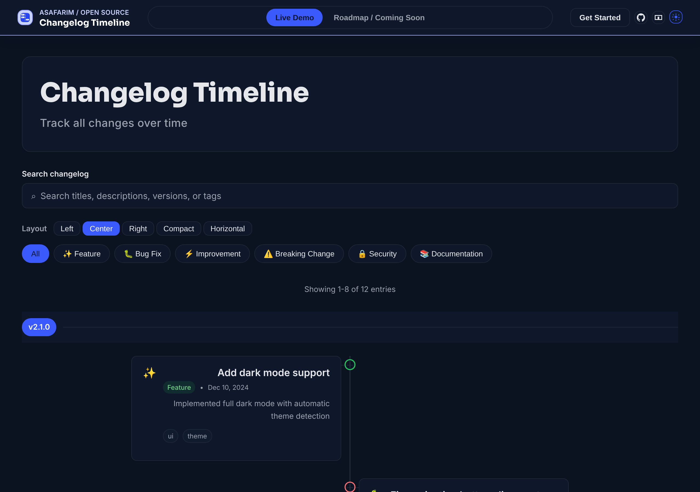
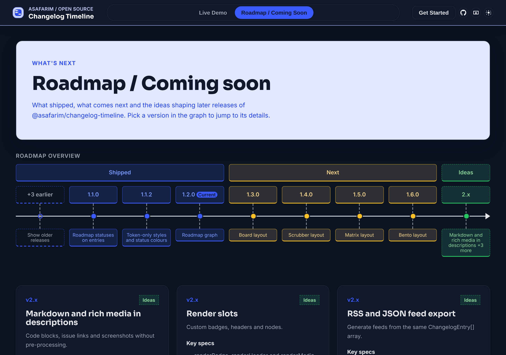
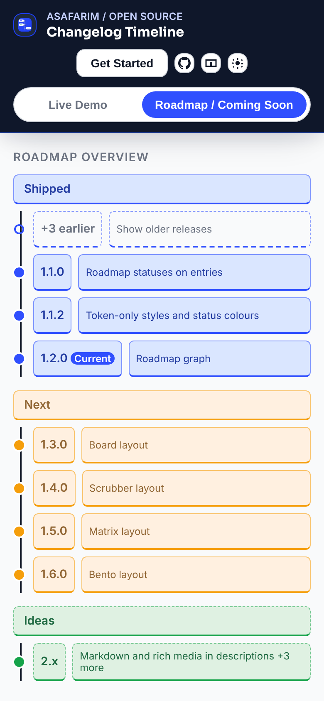
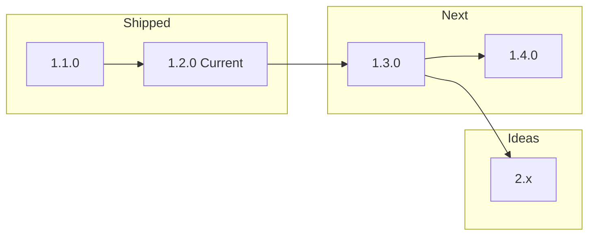

# @asafarim/changelog-timeline

A responsive, paginated vertical changelog timeline component built with React, TypeScript, and ASafariM design tokens. See demo at [https://alisafari-it.github.io/changelog-timeline/](https://alisafari-it.github.io/changelog-timeline/).

<!-- Screenshots live in docs/screenshots/v<version>/ and are linked through the release tag, so each published version keeps showing its own screenshots. -->
[](https://alisafari-it.github.io/changelog-timeline/)


## Features

`@asafarim/changelog-timeline` is a lightweight, token-driven React timeline component for changelogs and release notes, with filtering, pagination, and version grouping—packaged as a reusable library with a live demo and GitHub Pages preview.

- 🗺️ **Roadmap support** - entries carry a `status` (`shipped`, `in-progress`, `next`, `idea`), and `version` and `date` are optional for planned work
- 📊 **Roadmap overview graph** - Shipped / Next / Ideas bands over a version axis, shown above the cards
- ✨ **Five timeline types** - left, center, right, compact, and horizontal
- 🔀 **Optional layout switcher** so viewers can pick the type they prefer
- 🎨 **Powered by `@asafarim/design-tokens`** – no hard-coded colors
- 📱 **Fully responsive** - adapts from mobile to desktop
- 🔄 **Client-side pagination** with configurable page size
- 🏷️ **Category and status filtering** with visual badges
- 📦 **Version grouping** for organized display
- ♿ **Accessible** - ARIA labels, keyboard navigation, semantic HTML
- 🌗 **Automatic light/dark theme** support via tokens
- 🎯 **TypeScript** - fully typed API
- ⚛️ **React 18 and 19** supported
- 🌳 **Tree-shakable** - import only what you need

---

## Screenshots (1.2.0)

| Changelog, light | Changelog, dark |
|---|---|
|  |  |

| Roadmap, dark | Roadmap on a phone |
|---|---|
|  |  |

---

## Installation

```bash
pnpm add @asafarim/changelog-timeline
```

### Peer Dependencies

Works with React 18 and React 19.

```bash
pnpm add react react-dom
```

---

## Quick Start

```tsx
import { ChangelogTimeline } from '@asafarim/changelog-timeline';
import '@asafarim/changelog-timeline/css';

const entries = [
  {
    id: '1',
    version: '2.1.0',
    date: '2025-01-15T00:00:00Z',
    category: 'feature',
    title: 'Added dark mode support',
    description: 'Users can now toggle between light and dark themes.',
    tags: ['ui', 'accessibility'],
  },
  {
    id: '2',
    version: '2.0.1',
    date: '2025-01-10T00:00:00Z',
    category: 'fix',
    title: 'Fixed pagination bug',
    description: 'Resolved issue where pagination would skip entries.',
    tags: ['bug', 'pagination'],
  },
];

function App() {
  return (
    <ChangelogTimeline
      entries={entries}
      maxVisible={8}
      showPagination={true}
      searchable
    />
  );
}
```

---

## Roadmap and Coming Soon

Since 1.1.0 the same component renders a roadmap. Give entries a `status`; planned work can leave out `version` and `date`, and can group under a `milestone` (for example `2.x`) instead.

```tsx
import { ChangelogTimeline, type ChangelogEntry } from '@asafarim/changelog-timeline';

const roadmap: ChangelogEntry[] = [
  { id: 'r1', version: '1.2.0', date: '2026-11-20', status: 'shipped',
    category: 'feature', title: 'Roadmap graph', description: 'Shipped, Next and Ideas bands.', tags: [] },
  { id: 'r2', version: '1.3.0', status: 'next', quarter: 'Q1 2027',
    category: 'feature', title: 'Board layout', description: 'Kanban columns per status.', tags: ['layout'] },
  { id: 'r3', milestone: '2.x', status: 'idea', votes: 12,
    category: 'feature', title: 'Markdown descriptions', description: 'Opt-in markdown renderer.', tags: [] },
];

<ChangelogTimeline entries={roadmap} title="Roadmap" />
```

When the entries hold more than one status, the timeline shows:

1. the **Roadmap overview** graph first (click a version to jump to its cards),
2. status filter chips next to the category chips,
3. the cards, each with a status badge and its quarter and votes.



The graph shows the newest shipped versions (3 by default, `roadmapGraphMaxShipped`) and folds older ones into "+N earlier". Below 640px the axis turns vertical. Use `roadmapGraph={false}` to hide it, or `roadmapGraph` to force it on.

You can also render the graph on its own, for a Coming soon page that has its own cards:

```tsx
import { RoadmapGraph } from '@asafarim/changelog-timeline';

<RoadmapGraph
  entries={roadmap}
  onSelect={(key) => document.getElementById(`roadmap-${key}`)?.scrollIntoView()}
/>
```

| `RoadmapGraph` prop | Type | Default | Description |
|---------------------|------|---------|-------------|
| `entries` | `ChangelogEntry[]` | **required** | Entries to plot |
| `maxShipped` | `number` | `3` | Shipped versions shown before folding into "+N earlier" |
| `onSelect` | `(key: string) => void` | — | Called with the version or milestone key the viewer clicks |
| `selectedKey` | `string` | — | Highlights that version |
| `title` | `string` | `'Roadmap overview'` | Heading of the graph |
| `statusLabels` | `Partial<Record<EntryStatus, string>>` | — | Override the band labels, e.g. for translations |
| `className` | `string` | — | Extra CSS class |

Existing 0.9 changelogs keep working unchanged: entries without `status` count as `shipped`, and the graph only appears once the data holds more than one status.

---

## Comprehensive Tutorial: Build a Product Changelog in 5 Steps

> Everything below assumes a React 18 or 19 + TypeScript project that already uses PNPM.  
> The component auto-imports `@asafarim/design-tokens`, so **never hard-code colors, spacing, or typography**.

1. **Install dependencies**

   ```bash
   pnpm add @asafarim/changelog-timeline
   pnpm add react react-dom
   ```

2. **Model entries with `ChangelogEntry`**

   ```ts
   import type { ChangelogEntry } from '@asafarim/changelog-timeline';

   const entries: ChangelogEntry[] = [
     {
       id: 'release-2.1.0-feature-dark-mode',
       version: '2.1.0',
       date: '2025-01-15',
       category: 'feature',
       title: 'Added dark mode',
       description: 'Timeline now follows the active theme automatically.',
       tags: ['ui', 'accessibility'],
     },
   ];
   ```

3. **Import CSS tokens once**

   ```ts
   import '@asafarim/changelog-timeline/css';
   ```

4. **Render the component**

   ```tsx
   import { ChangelogTimeline } from '@asafarim/changelog-timeline';

   export const ProductChangelog = () => (
     <ChangelogTimeline
       entries={entries}
       title="Product updates"
       subtitle="Fresh releases and fixes"
       layout="center"
       maxVisible={6}
       showPagination
     />
   );
   ```

5. **Deploy with confidence**

   Works in Vite, Next.js (SSR/ISR), CRA, Remix, and any bundler that understands ESM. The component is fully typed, accessible, and token-driven.

---

## Design Token Usage

This library is **100% token-based**. All colors, spacing, typography, shadows, and transitions come from `@asafarim/design-tokens` (auto-imported when you import `@asafarim/changelog-timeline/css`).

### Token Categories Used

| Token Type | Examples |
|------------|----------|
| **Colors** | `var(--asm-color-brand-primary-600)`, `var(--asm-color-semantic-success)`, `var(--asm-color-text)` |
| **Spacing** | `var(--asm-space-2)`, `var(--asm-space-4)`, `var(--asm-space-8)` |
| **Typography** | `var(--asm-font-size-sm)`, `var(--asm-font-size-md)`, `var(--asm-line-height-relaxed)` |
| **Radius** | `var(--asm-radius-sm)`, `var(--asm-radius-md)` |
| **Shadows** | `var(--asm-effect-shadow-sm)`, `var(--asm-effect-shadow-md)` |
| **Transitions** | `var(--asm-motion-duration-fast)`, `var(--asm-motion-easing-standard)` |

### Category Color Mapping

Each changelog category automatically maps to semantic token colors:

| Category | Primary Token | Notes |
|----------|---------------|-------|
| `feature` | `--asm-color-semantic-success` | Used for icon & label text |
| `fix` | `--asm-color-semantic-error` | |
| `improvement` | `--asm-color-semantic-info` | |
| `security` | `--asm-color-semantic-warning` | |
| `breaking` | `--asm-color-semantic-error` | |
| `docs` | `--asm-color-brand-primary-600` | |

---

## Component API

### `<ChangelogTimeline>`

Main timeline component.

#### Props

| Prop | Type | Default | Description |
|------|------|---------|-------------|
| `entries` | `ChangelogEntry[]` | **required** | Entries displayed in the timeline |
| `className` | `string` | `''` | Additional CSS class for the timeline |
| `headerClassName` | `string` | `''` | Additional CSS class for the header |
| `maxVisible` | `number` | `8` | Entries per page |
| `showPagination` | `boolean` | `true` | Show pagination controls |
| `searchable` | `boolean` | `false` | Show text search across title, description, version, and tags |
| `layout` | `'left' \| 'center' \| 'right' \| 'compact' \| 'horizontal'` | `'left'` | Timeline type (see [Timeline Types](#timeline-types)) |
| `layoutSwitcher` | `boolean \| TimelineLayout[]` | `false` | Show a control that lets the viewer pick the timeline type. Pass an array to offer a subset |
| `onLayoutChange` | `(layout: TimelineLayout) => void` | — | Called when the viewer picks a type in the switcher |
| `title` | `string` | — | Optional timeline heading |
| `subtitle` | `string` | — | Optional timeline subheading |
| `roadmapGraph` | `boolean` | auto | Show the Roadmap overview graph above the cards. Defaults to on when entries hold more than one `status` |
| `roadmapGraphMaxShipped` | `number` | `3` | Shipped versions shown in the graph before older ones fold into "+N earlier" |

---

### `ChangelogEntry`

```typescript
interface ChangelogEntry {
  id: string;
  version?: string;      // optional for planned work
  date?: string;         // ISO 8601, optional for planned work
  category: 'feature' | 'fix' | 'improvement' | 'security' | 'breaking' | 'docs';
  title: string;
  description: string;
  tags: string[];
  status?: 'shipped' | 'in-progress' | 'next' | 'idea'; // default 'shipped'
  milestone?: string;    // groups entries without a version, e.g. '2.x'
  quarter?: string;      // e.g. 'Q1 2027'
  votes?: number;
}
```

### Other exports

| Export | Purpose |
|--------|---------|
| `RoadmapGraph` | The roadmap overview graph on its own |
| `ENTRY_STATUSES`, `STATUS_LABELS` | The status values and their labels (Shipped, In progress, Next, Ideas) |
| `normalizeEntries`, `groupKeyOf`, `compareVersions` | Fill defaults, group keys and semver-aware sorting |
| `groupByVersion`, `groupByMilestone`, `groupByStatus`, `groupByStatusAndCategory`, `useGroupLimit` | Grouping helpers for custom layouts |
| `useTimelineState` | Search, category, status, layout and pagination state, for building your own view |

---

## Usage Examples

### Basic Timeline

```tsx
<ChangelogTimeline entries={entries} />
```

### With Category Filtering

Category filter chips are included by default:

```tsx
<ChangelogTimeline entries={entries} />
```

### Centered Layout

```tsx
<ChangelogTimeline
  entries={entries}
  layout="center"
  title="Product updates"
  subtitle="Fresh releases and fixes"
/>
```

### Timeline Types

| `layout` | Description |
|----------|-------------|
| `left` | Axis on the left, cards to its right (default) |
| `center` | Axis in the middle, cards alternate left and right |
| `right` | Axis on the right, cards to its left |
| `compact` | Dense one-line rows without cards, for long changelogs |
| `horizontal` | Entries of each version run left to right in a scrollable row |

On screens up to 640px wide, `center` and `horizontal` fall back to the single-column left-axis layout.

```tsx
<ChangelogTimeline entries={entries} layout="horizontal" />
```

### Let Viewers Choose the Type

`layoutSwitcher` adds a control above the filters. `layout` sets the starting type, and `onLayoutChange` reports each choice so you can save it.

```tsx
const [layout, setLayout] = useState<TimelineLayout>(
  () => (localStorage.getItem('changelog-layout') as TimelineLayout) ?? 'center'
);

<ChangelogTimeline
  entries={entries}
  layout={layout}
  layoutSwitcher={['left', 'center', 'compact']}
  onLayoutChange={(next) => {
    setLayout(next);
    localStorage.setItem('changelog-layout', next);
  }}
/>
```

### Client-Side Pagination

```tsx
<ChangelogTimeline
  entries={entries}
  maxVisible={10}
  showPagination={true}
/>
```

### Rich Media and Markdown

Markdown parsing and rich media rendering are planned features. Until then, pass plain text descriptions to `ChangelogTimeline` or preprocess content in your application.

---

## Theming

The timeline automatically adapts to light/dark themes via `@asafarim/design-tokens`.

### Custom Theme Extension

You can extend the theme by overriding token variables:

```css
:root {
  /* Override timeline-specific tokens */
  --timeline-dot-size: 20px;
  --timeline-gap: var(--asm-space-10);

  /* Override category colors */
  --category-feature-bg: rgba(34, 197, 94, 0.15);
  --category-feature-text: var(--asm-color-semantic-success);
}
```

---

## Accessibility

- ✅ Semantic HTML (`<time>`, `<h2>`, `<h3>`)
- ✅ ARIA labels (`role="list"`, `aria-label`, `aria-pressed`)
- ✅ Keyboard navigation (Tab, Enter, Space)
- ✅ Focus indicators (`outline`, `focus-visible`)
- ✅ Screen reader friendly

---

## Browser Support

- Chrome/Edge (latest 2 versions)
- Firefox (latest 2 versions)
- Safari (latest 2 versions)
- Mobile browsers (iOS Safari, Chrome Android)

---

## Development

The repository uses PNPM workspaces. CI runs Node.js 26 with pnpm 12.21.0 for reproducible installs and builds.

### Build

```bash
pnpm build
```

### Preview

```bash
pnpm preview
```

### Screenshots for a release

Every release gets its own folder, `docs/screenshots/v<version>/`, and the README links those files through the release tag (`raw.githubusercontent.com/AliSafari-IT/changelog-timeline/v<version>/docs/screenshots/v<version>/...`). Never overwrite an older folder: that keeps every published README showing the screenshots of its own version. `pnpm release` rewrites only the tag segment of those links (`.../v<version>/...`); it does not change the folder segment. It stops before tagging when `docs/screenshots/v<version>/` is empty, not linked from the README, or not committed, and it stages that folder with the release commit.

### Clean

```bash
pnpm clean
```

### Test

```bash
pnpm test        # Vitest
pnpm typecheck
```

### Run the demo

```bash
pnpm demo
```

The demo builds the library first, then starts Vite at `http://localhost:5187/changelog-timeline/`.

---

## Demo App

The `changelog-demo` app includes:

- Live changelog filtering and pagination
- Light/dark theme toggle
- Responsive token-based layout
- `Live Demo` and `Roadmap / Coming Soon` views
- A Roadmap tab built from this package's own roadmap: the overview graph first, then a card per version

The hosted demo is available at [alisafari-it.github.io/changelog-timeline](https://alisafari-it.github.io/changelog-timeline/).

---

## Versioning

The package follows semver from 1.0.0: each new feature adds a minor version (1.2.0 → 1.3.0), and each change within a shipped feature adds a patch (1.2.0 → 1.2.1). The library and the demo share one version.

---

## License

MIT © ASafariM

---

## Contributing

Contributions welcome! Please ensure:

- All colors/spacing use tokens from `@asafarim/design-tokens`
- TypeScript types are complete
- Components are accessible
- Code follows existing patterns

---
